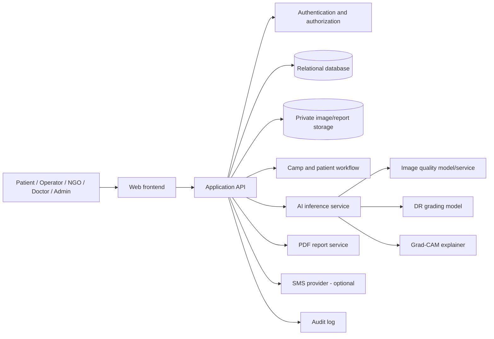

# Architecture

**Status:** Logical reference architecture. The actual framework, database, hosting, and providers must be confirmed by repository inspection before implementation.

## 1. Architecture goals

- Separate user experience, application workflow, AI inference, persistence, and external communications.
- Enforce organization and doctor assignment access on the server/database, not only in the UI.
- Keep AI inference reproducible through model and preprocessing versioning.
- Store retinal images privately.
- Make failures and uncertainty explicit.

## 2. Logical architecture

## 3. Frontend

Responsibilities:
- Role-aware navigation and screens.
- Camp link/QR entry.
- Patient registration and consent.
- Separate right/left image capture/upload.
- Quality status and retake guidance.
- AI result and heatmap presentation.
- Doctor review queue and form.
- Report access and follow-up status.
- Organization and administrator management.

Rules:
- Frontend route guards improve UX but are not security boundaries.
- Never embed service-role keys, model secrets, or provider credentials.
- Do not hardcode demo counts or fake model outputs.
- Clearly label AI output and doctor assessment separately.

## 4. Application backend

Responsibilities:
- Authenticate requests and enforce role/organization/case scope.
- Validate input and uploaded files.
- Create camps, patients, screenings, assignments and follow-ups.
- Issue short-lived authorized access to private images/reports.
- Orchestrate quality assessment and AI inference.
- Persist model output and audit events.
- Generate preliminary and doctor-reviewed reports.
- Integrate SMS only when configured.

A Python FastAPI service is a suitable option if the AI model runs in Python. If the current project already uses another backend, document and retain it unless a reviewed decision justifies a separate inference service.

## 5. AI inference service

Suggested internal operations:
- `assess_image_quality(image) -> quality_state, quality_scores, reasons`
- `classify_dr(image) -> grade, logits/probabilities, model_version`
- `generate_gradcam(image, target_class) -> heatmap, explainer_version`

The model service must:
- Use the same documented preprocessing as training/evaluation.
- Validate image dimensions, channels, decoding, and file limits.
- Return structured errors and explicit unavailable/uncertain states.
- Record model and preprocessing versions.
- Avoid treating model confidence as calibrated probability unless calibration has been evaluated.
- Never substitute random/demo output for real inference.

Lesion segmentation and vessel segmentation are separate model capabilities. They must not be implied by a classifier or Grad-CAM.

## 6. Data architecture

Candidate relational entities:
- `organizations`
- `users` / identity mapping
- `camps`
- `patients`
- `consents`
- `screening_cases`
- `eye_images`
- `image_quality_results`
- `ai_results`
- `explainability_artifacts`
- `doctor_reviews`
- `follow_ups`
- `reports`
- `audit_logs`

Use foreign keys and constraints to prevent cross-case and wrong-eye association. Use append-only history for significant clinical/workflow changes where feasible.

### Storage
- Database stores metadata and private object keys, not public image URLs.
- Object storage holds original images, generated heatmaps, and reports.
- Access should use authenticated authorization or short-lived signed URLs.
- Define retention and deletion policies with clinical/legal stakeholders.

## 7. API boundaries

Illustrative API surface (not a claim that these endpoints already exist):

| Method | Route | Purpose |
|---|---|---|
| POST | `/api/camps` | Create camp |
| GET | `/api/camps/assigned` | List camps for operator |
| POST | `/api/patients` | Register patient and consent |
| POST | `/api/screenings` | Create screening episode |
| POST | `/api/screenings/{id}/images` | Upload image with eye side |
| POST | `/api/eye-images/{id}/assess` | Run quality/AI workflow |
| GET | `/api/screenings/{id}/preliminary-report` | Retrieve AI report |
| GET | `/api/doctor/cases` | List assigned cases |
| POST | `/api/cases/{id}/doctor-review` | Record doctor assessment |
| POST | `/api/cases/{id}/follow-ups` | Create/update follow-up |
| GET | `/api/reports/{id}` | Authorized report retrieval |

All routes require authentication and object-level authorization except explicitly public, minimal camp-registration entry points. Public registration tokens must be scoped, revocable, and rate-limited.

## 8. Access model

- Patient: own records/reports only, through verified identity or secure report access.
- Operator: assigned camps and patients within those camps.
- Organization: records, staff and camps belonging to its organization.
- Doctor: assigned cases within the authorized organization.
- Platform administrator: privileged cross-organization operations with audit logging.

Enforce authorization in backend/database policies on every operation.

## 9. Deployment topology

A possible deployment separates:
- Static/web frontend.
- Application API.
- AI inference worker/service.
- Managed relational database.
- Private object storage.
- Optional SMS provider.

The actual hosting plan depends on model size, CPU/GPU availability, memory, inference latency, privacy requirements, and budget. Do not choose a host solely because it can serve a static frontend.

## 10. Observability

Log operational metadata, not raw patient images or unnecessary personal data:
- Request/correlation ID.
- Actor and organization identifiers where safe.
- Operation, status, latency, model version.
- Failure category.
- Audit event reference.

Monitor failed uploads, inference errors, queue backlog, report generation, SMS delivery, and suspicious access patterns.
