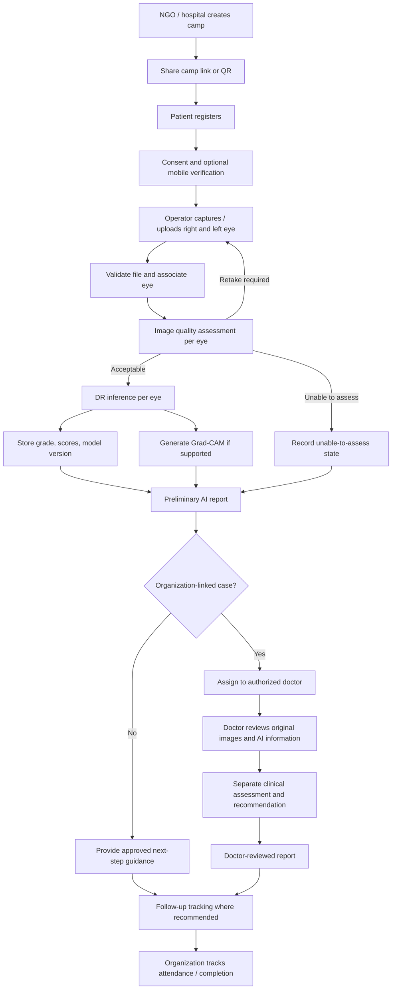
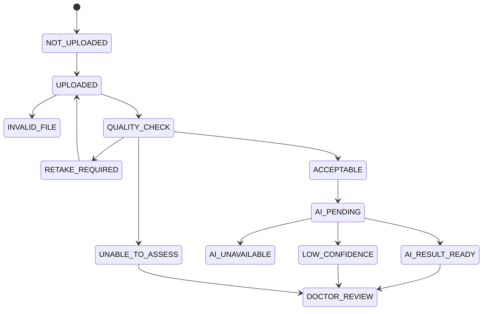

# System Design

**Product:** RETINA AI  
**Status:** Proposed logical design; confirm implementation details against the repository.

## 1. Design principles

- Build around the complete screening-to-follow-up journey.
- Keep each eye's image and result independent.
- Preserve uncertainty: missing, poor-quality, low-confidence, and unavailable are explicit states.
- AI output and doctor assessment are separate.
- Organization and assignment boundaries apply to every read/write.
- Do not show a feature unless its service is actually available.

## 2. End-to-end workflow

## 3. User journeys

### 3.1 NGO / hospital
1. Sign in.
2. Complete organization profile and approval process.
3. Create camp with location/date/capacity.
4. Add operators and doctors.
5. Set staff access and case assignment policy.
6. Share camp link/QR with community.
7. Monitor camp progress, case queues, referrals, and follow-up.

### 3.2 Patient
1. Open camp link/QR or receive operator assistance.
2. Enter required details.
3. Verify mobile number if enabled.
4. Review screening and privacy notice; provide consent.
5. Attend image capture for both eyes.
6. Receive secure access to preliminary report and, if completed, separate doctor-reviewed report.
7. Follow the instructions from the healthcare provider.

### 3.3 Screening operator
1. Sign in and select an assigned camp.
2. Register or locate patient.
3. Confirm consent status.
4. Capture/upload right-eye image and label it `RIGHT`.
5. Capture/upload left-eye image and label it `LEFT`.
6. Review quality result for each eye.
7. Retake unsuitable images or record why an eye is unavailable.
8. Submit eligible images for AI processing.
9. Track processing and review status.

### 3.4 Doctor
1. Sign in.
2. Open assigned case queue.
3. Review original right/left images, quality state, AI grade, confidence, and supported visualizations.
4. Record an independent clinical assessment.
5. Agree/disagree with AI output where appropriate.
6. Record recommendation, facility, and follow-up date.
7. Sign off the doctor-reviewed report.

### 3.5 Platform administrator
1. Review organization applications.
2. Approve/reject organizations.
3. Create, suspend, or reactivate accounts.
4. Handle access/correction/deletion requests.
5. Review audit and service activity.

## 4. Per-eye assessment state machine

The state machine is conceptual. Implementation may use normalized status fields and append-only history rather than a single mutable state.

## 5. Overall case summary

- Retain right-eye and left-eye status and result separately.
- If both eyes have valid grades, the overall screening summary may reflect the more severe grade.
- If one eye is missing, mark it `NOT_ASSESSED`.
- If an eye is unsuitable, mark it `UNABLE_TO_ASSESS` or `RETAKE_REQUIRED`.
- If AI is unavailable, show `AI_UNAVAILABLE`.
- If confidence is low, preserve the low-confidence flag and route according to the clinically approved workflow.
- Never infer Grade 0 from absence of a result.

## 6. Doctor queue and case statuses

Proposed case statuses:
- `PENDING_REVIEW`
- `UNDER_REVIEW`
- `REVIEWED`
- `FOLLOW_UP_PENDING`
- `FOLLOW_UP_COMPLETED`

Proposed queue order from the extended concept:
1. Urgent cases (only if urgency is determined under a clinically approved rule).
2. Unable-to-assess cases.
3. Other cases, oldest first.

The queue order and urgency labels must be confirmed by clinical partners; they are not a substitute for triage policy.

## 7. Reports

### Preliminary AI screening report
- Screening and patient reference.
- Camp/organization reference.
- Eye-wise images and quality statuses.
- Eye-wise AI grade and model confidence/scores where supported.
- Grad-CAM or other visualizations only when generated by an available model.
- Explicit unavailable/uncertain/not-assessed states.
- Clear notice: AI-assisted preliminary screening information, not diagnosis.

### Doctor-reviewed report
- Doctor identity and sign-off metadata.
- Independent clinical assessment.
- Notes and recommendation.
- Follow-up date/facility/instructions.
- Must remain separate from the AI report and preserve history.

## 8. Patient communications

The concept proposes:
- SMS notification to a verified number that a report is ready, with a secure link.
- PDF report accessible through that link.
- Separate AI preliminary and doctor-reviewed reports.
- SMS should not contain grade or diagnosis.

Delivery is conditional on provider setup, secure tokenized links, expiry/revocation, consent, and operational testing.

## 9. Main data entities

| Entity | Purpose |
|---|---|
| Organization | NGO/hospital profile and approval |
| User | Login identity, role, organization and access status |
| Camp | Organization's screening event |
| Patient | Minimal personal details, consent and optional history |
| Screening case | Patient's screening episode and workflow status |
| Eye image | Right/left image, storage key, capture metadata and quality state |
| AI result | Grade, scores, model/preprocessing version, inference state |
| Explainability artifact | Grad-CAM image and generation metadata |
| Doctor review | Separate assessment, notes, recommendation and sign-off |
| Follow-up | Date, facility, next step, attendance and status |
| Report | AI report or doctor-reviewed report, version and access policy |
| Audit event | Actor, action, target, timestamp and outcome |

## 10. Failure and exception paths

- Invalid file: reject with actionable message; do not invoke model.
- Image decode or quality service failure: report technical failure or unable-to-assess; do not claim image is good.
- AI timeout/unavailable: preserve uploaded image and show AI unavailable.
- Low confidence: show uncertainty and route to approved review path.
- Only one eye captured: mark other eye not assessed.
- SMS failure: retain report securely and show delivery status; do not expose report in SMS.
- Network interruption: do not claim offline support unless queued storage and later synchronization are implemented and tested.
- Doctor unavailable: keep case pending and make it visible to authorized organization staff.

## 11. Workflow measures

Measure:
- Registration-to-image time.
- Image retake frequency and success.
- Time to preliminary result.
- AI unavailable/low-confidence rate.
- Doctor queue age.
- Referral attendance and follow-up completion.
- Abandoned or incomplete screening cases.
